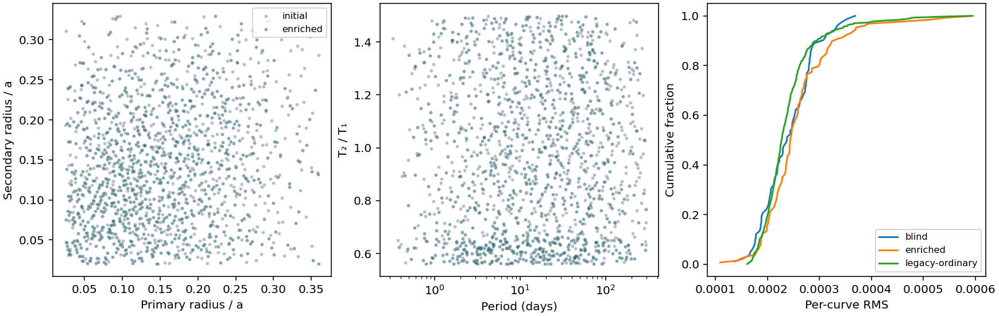
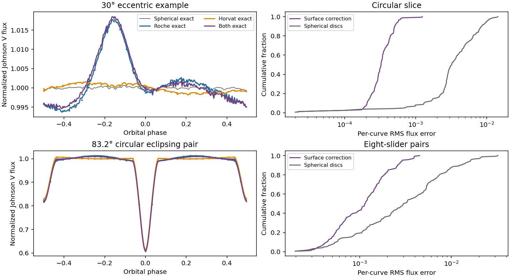
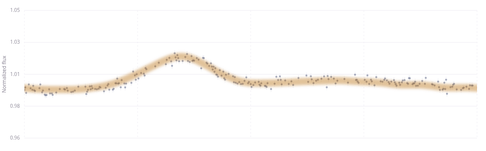

# Detached-binary light curves and surface drag previews

PHOEBE 2.5.4 returned **3,103 finite exact curves in 4,457 new design attempts**. The selected wider spherical fit trained on 1,453 new geometries. The circular inclination–radius slice recovered tides plus heating on 54 held-out systems with RMS **0.000423**, compared with **0.005599** for the spherical disc prediction. All flux errors below use median-normalized Johnson V flux before scaling to observations.

[GitHub review and compact artifacts](https://github.com/paulnord/phoebe-lab-preview/pull/1)

## What the catalog supports

The 2017-10-10 CDS edition of DEBCat contains 195 detached eclipsing systems. For each system we exponentiated the catalog base-10 masses, radii and temperatures, and computed a³ = G(M₁ + M₂)P²/(4π²). Each fractional radius is the component radius divided by this semimajor axis. Ratios preserve the catalog component labels. Quantiles are unweighted system quantiles over finite entries, with missing values excluded. [Southworth, DEBCat](https://arxiv.org/abs/1411.1219) · [CDS table and field definitions](https://cdsarc.cds.unistra.fr/viz-bin/ReadMe/V/152?format=html)

| Quantity | N | Min | 5% | Median | 95% | Max |
| --- | --- | --- | --- | --- | --- | --- |
| period | 195 | 0.452 | 1.295 | 4.135 | 199.2 | 1550 |
| mass_ratio | 195 | 0.2067 | 0.6015 | 0.9268 | 1.017 | 1.114 |
| radius_primary | 195 | 0.008815 | 0.02719 | 0.1215 | 0.2776 | 0.3747 |
| radius_secondary | 195 | 0.004768 | 0.02192 | 0.1081 | 0.2497 | 0.3533 |
| temperature_ratio | 195 | 0.5848 | 0.7362 | 0.9683 | 1.047 | 1.352 |
| T1 | 195 | 2891 | 3793 | 6427 | 2.793e+04 | 3.802e+04 |

DEBCat emphasizes detached eclipses with precise masses and radii. Eclipse geometry, brightness, spectroscopy and the precision requirement select which systems enter. The fixed 6,300 K primary is close to the catalog median. It excludes large parts of the absolute temperature distribution. A mass ratio up to 2 and a hotter secondary up to 1.50 are simulation challenges beyond the upper catalog quantiles. Long periods and small fractional radii are present in the catalog. This table has no inclination, eccentricity or periastron-angle column. Their bounds and the non-eclipsing sampling fraction are experimental choices. [Southworth](https://arxiv.org/abs/1411.1219)

Prša et al. parameterize detached light curves using temperature ratio, summed fractional radii, inclination and the eccentricity-vector components. We use that geometry for grazing stresses and periodic features e cos ω and e sin ω. Their first Kepler release covered 44 days and had a different passband and selection function. It supplies geometric motivation, while Johnson V targets come from PHOEBE. [Prša et al., Kepler eclipsing binaries](https://arxiv.org/abs/1006.2815)

## Exact design and split integrity

The old joint domain spanned i = 65–90°, r₁ = 0.10–0.32, r₂ = 0.08–0.29, T₂/T₁ = 0.58–1.10, q = 0.20–1.50, P = 0.1–100 d, e = 0–0.35 and all periastron angles. The wider design sampled i = 0–90°, r₁ = 0.025–0.36, r₂ = 0.02–0.33, T₂/T₁ = 0.56–1.50, q = 0.15–2, log-period from 0.3 to 300 d, e = 0–0.65 and ω = 0–360°. These are sampling bounds. Independently varying mass ratio, radius and temperature does not enforce coeval stellar evolution. Each row still requires a detached solution and valid local atmosphere interpolation.

Scrambled Sobol designs use separate split seeds. The first sample mixes isotropic and eclipse-favoured inclinations. Separate held-out designs traverse a correlated track, hit faces and perturb external contact. The first 1,280 spherical training draws gave 560 exact successes. We added 896 training and 128 independent challenge geometries with surface gravities of 1.7–4.9 and fractional radii below 88% of an estimated periastron Roche-lobe radius. This enrichment favours eclipses and deliberately samples cool secondaries and grazing contact. The periastron scaling is a proposal filter. PHOEBE evaluates the eccentric geometry. [Eggleton, effective Roche-lobe radii](https://doi.org/10.1086/160960)

The forward model fixes primary mass at 1.2 M☉, primary temperature at 6,300 K, synchronous rotation, solar abundance, gravity brightening at 0.32 and reflected bolometric fraction at 0.6 on both stars. These surface coefficients limit physical interpretation for hotter radiative stars. The ordinary targets use 256 phases on [−0.5, 0.5), 400 triangles per star, interpolated ck2004 limb intensities and energy weighting. T₂ begins at 3,528 K, just above the 3,500 K table boundary. A ratio of 0.55 would put the secondary at 3,465 K and was excluded. An average temperature inside the table does not guarantee every Roche surface element has covered temperature and gravity. The spherical predictor requires valid atmosphere corners at both stars, including gravity. The exact engine records Roche and atmosphere failures. [PHOEBE surface model](https://doi.org/10.3847/1538-4365/227/2/29) · [Horvat et al., irradiation](https://arxiv.org/abs/1809.07963)

Every physical system and all of its surface/mesh variants share a split. Canonical identities fold ω at 360° and ignore ω on circular orbits. The audit checked 7,151 historical reserved geometries. The compatible archive contains 20,298 training curves with the same mass, passband, exact settings, phase grid and sample-median normalization. The pooled candidates used all eligible historical curves. Validation selected the new-only fit. The eight-slider release keeps its original guardrails in the main lab.


| Quantity | Minimum successful training value | Median | Maximum successful training value |
| --- | --- | --- | --- |
| inclination | 0.3201 | 76.87 | 90 |
| radius_primary | 0.02501 | 0.1483 | 0.3596 |
| radius_secondary | 0.02005 | 0.1392 | 0.3299 |
| temperature_ratio | 0.5605 | 0.9552 | 1.498 |
| mass_ratio | 0.1517 | 1.076 | 1.999 |
| period | 0.3247 | 14.74 | 295.3 |
| eccentricity | 0.0002338 | 0.1941 | 0.6482 |
| omega | 0.04139 | 179.5 | 359.7 |

## Wider spherical fit

We tabulated Johnson V intensities over valid ck2004 cells, used the eccentric orbit and limb-darkened annuli to compute spherical flux, then fit residuals with ridge regression on physical coordinates and deterministic tanh features. Heads predict phase samples, 16 Fourier harmonics, or four eclipse-aligned profile coefficients. Pooled fits give the historical archive and new training group equal total weight. Each candidate sees exactly the same validation cases. We select by per-curve flux pass count (RMS ≤ 0.005 and pointwise maximum ≤ 0.035), then pooled RMS. The tables give sample error, with each valid curve weighted equally.

Validation selected **fourier-new-1453**. The initial fit on 560 wider curves selected fourier-pooled-560. Learning-curve rows below give the best validation candidate at each nested new-data size.

| New training | History weighting | Best head | Validation RMS | Worst point |
| --- | --- | --- | --- | --- |
| 192 | new | disc | 0.000298 | 0.001655 |
| 192 | pooled | fourier | 0.000295 | 0.001422 |
| 512 | new | fourier | 0.000260 | 0.001377 |
| 512 | pooled | fourier | 0.000257 | 0.001340 |
| 1453 | new | fourier | 0.000240 | 0.001326 |
| 1453 | pooled | fourier | 0.000242 | 0.001318 |


| Held-out group | Scored | Exact/disc exclusions | Disc RMS | Fit RMS | 95% curve RMS | Worst point | Flux passes |
| --- | --- | --- | --- | --- | --- | --- | --- |
| blind | 82 | 110 | 0.000322 | 0.000246 | 0.000332 | 0.003021 | 82 |
| boundary | 11 | 21 | 0.000315 | 0.000248 | 0.000345 | 0.001121 | 11 |
| grazing | 15 | 17 | 0.000288 | 0.000244 | 0.000315 | 0.000944 | 15 |
| track | 13 | 4 | 0.000367 | 0.000241 | 0.000310 | 0.001278 | 13 |
| enriched | 128 | 0 | 0.000334 | 0.000267 | 0.000370 | 0.003780 | 128 |
| legacy-ordinary | 606 | 162 | 0.000341 | 0.000245 | 0.000342 | 0.001927 | 606 |
| legacy-stress | 176 | 49 | 0.000312 | 0.000234 | 0.000309 | 0.001876 | 176 |

On 606 matched legacy-ordinary curves, the actual existing eight-slider browser predictor gave RMS 0.000282 and worst 0.005824. The wider fit gave RMS 0.000245 and worst 0.001927.

On 176 matched legacy-stress curves, the actual existing eight-slider browser predictor gave RMS 0.000268 and worst 0.005201. The wider fit gave RMS 0.000234 and worst 0.001876.


| New blind subset | N | Fit RMS | Worst point |
| --- | --- | --- | --- |
| geometric_eclipse | 48 | 0.000257 | 0.003021 |
| no_eclipse | 34 | 0.000229 | 0.000981 |
| hotter_secondary | 39 | 0.000249 | 0.001338 |
| cool_secondary | 11 | 0.000260 | 0.003021 |
| high_eccentricity | 18 | 0.000243 | 0.001410 |
| low_inclination | 27 | 0.000212 | 0.000862 |

The browser comparison recomputes the wider fit at held-out physical vectors with measured exact curves. Free dragging in the main lab continues to use its existing spherical predictors. The comparison viewer provides access to weak and strong fits across the wider sample without asserting validity everywhere inside the sampling bounds.



## Paired surface corrections

At each paired geometry, PHOEBE evaluated spheres with irradiation off, both stars Roche-distorted with irradiation off, spheres with Horvat irradiation, and Roche surfaces with Horvat irradiation. Each mode has its own median normalization. Mode differences therefore include the normalization response. The interaction is both − tides − heating + sphere. On the slices we interpolate paired surface-minus-sphere targets and add the current disc flux at the requested inclination and radius. Candidate heads use direct phase samples or 4, 12 and 32 harmonics, with separate combined-mode fits compared to adding the individual effects.

The circular grid has 14 inclinations and five primary radii at fixed r₂ = 0.17, T₂/T₁ = 0.845, q = 0.77, P = 1.83 d, e = 0 and ω = 90°. It varies inclination from 0° to 90° and r₁ from 0.14 to 0.28. The eccentric slice varies inclination from 18° to 46° at the shipped eccentric example’s other coordinates. Its exact 30° example stayed blind. The broad experiment compared models using all eight physical inputs, with 148 complete eligible four-mode training systems available and selection on 11 independent sets. It compares a phase-dependent tidal and illumination fit with direct and Fourier residuals. The selections were 70-32-mode, 8-12-mode and 53-fourier4, respectively. A slice label gives training knots, harmonic count (0 means direct samples) and whether the combined correction uses its own mode. A broad label gives training systems and the residual head.

| Study | Mode | Held-out N | Spherical RMS | Surface RMS | 95% curve RMS | Worst point | Flux passes |
| --- | --- | --- | --- | --- | --- | --- | --- |
| Circular | Roche tides | 54 | 0.006507 | 0.000424 | 0.000584 | 0.002671 | 54 |
| Circular | Horvat heating | 54 | 0.002474 | 0.000283 | 0.000420 | 0.001392 | 54 |
| Circular | Both | 54 | 0.005599 | 0.000423 | 0.000584 | 0.002630 | 54 |
| Eccentric | Roche tides | 7 | 0.006956 | 0.000378 | 0.000426 | 0.001436 | 7 |
| Eccentric | Horvat heating | 7 | 0.001165 | 0.000255 | 0.000282 | 0.000813 | 7 |
| Eccentric | Both | 7 | 0.007070 | 0.000382 | 0.000428 | 0.001415 | 7 |
| Eight sliders | Roche tides | 56 | 0.009146 | 0.001225 | 0.002390 | 0.014842 | 56 |
| Eight sliders | Horvat heating | 56 | 0.003155 | 0.001558 | 0.003672 | 0.014049 | 56 |
| Eight sliders | Both | 56 | 0.008693 | 0.001906 | 0.003528 | 0.016366 | 56 |

Slice acceptance also requires eclipse-depth error ≤ 0.03, width error ≤ 0.005 cycles, and lower pooled RMS than the spherical baseline in every mode. The eccentric slice additionally requires recovery of the 30° modulation amplitude to within 20% in each mode. Both sampled slices passed those checks. The unrestricted eight-slider surface fit is withheld from drag use. Its largest combined-mode error was 0.016366 at wide-blind-0012.

On the circular grid each of the 52 blind systems and two additional in-slice probes entered the reported scores. The nominal 30° probe uses different q, period and temperature ratio, so the guard declines it. On the eccentric slice seven geometries entered blind scoring. The 30° system has r₁ = 0.312, r₂ = 0.134, T₂/T₁ = 0.845, q = 0.47, P = 11.39 d, e = 0.18 and ω = 27°.

All 168 broad held-out mode targets passed the absolute flux limits. The 148-system fit had worse validation RMS than the 53-system fit, so the latter supplied the frozen broad predictions. On the separately sampled eccentric inclination slice the general model's heating-only RMS was 0.001258, compared with 0.001165 for spherical discs and 0.000255 for the slice model. We rejected unrestricted broad dragging because heating improvement did not transfer to that slice and only 11 geometries were available for broad validation.


| 30° example | Exact peak-to-peak | Predicted peak-to-peak | RMS |
| --- | --- | --- | --- |
| tides | 0.024035 | 0.023287 | 0.000444 |
| heat | 0.003429 | 0.002768 | 0.000241 |
| both | 0.023914 | 0.023116 | 0.000397 |

The following maximum errors use geometric contact to identify eclipses. Each curve’s local continuum is interpolated across the occulted interval. Half-depth width, midpoint and 10–90% ingress/egress require depth ≥ 0.01 in both curves. Minimum phase can be ambiguous in shallow or flat-bottomed eclipses. Before/after errors cover the four phase samples immediately outside geometric contact. Strong distortion can move actual contact relative to this spherical geometric mask.

| Group | Depth | Width | Midpoint | Minimum phase | Ingress | Egress | Before | After | Outside |
| --- | --- | --- | --- | --- | --- | --- | --- | --- | --- |
| Wide blind | 0.001087 | 0.001263 | 0.000378 | 0.035156 | 0.001356 | 0.001708 | 0.000937 | 0.000779 | 0.001054 |
| Circular both | 0.001327 | 0.000419 | 0.000188 | 0.011719 | 0.000783 | 0.001199 | 0.002259 | 0.001858 | 0.002259 |
| Eight-slider both | 0.016369 | 0.002642 | 0.000517 | 0.003906 | 0.002134 | 0.001476 | 0.007676 | 0.008359 | 0.008359 |

On the circular systems the exact interaction had RMS 0.001837. Interaction prediction error was 0.000162.

On the eccentric systems the exact interaction had RMS 0.000655. Interaction prediction error was 0.000191.

On the eight-slider systems the exact interaction had RMS 0.001841. Interaction prediction error was 0.001493.




| Broad surface benchmark | Mode | Scored | RMS | Worst point | Flux passes |
| --- | --- | --- | --- | --- | --- |
| ordinary | tides | 24 | 0.001480 | 0.014842 | 24 |
| ordinary | heat | 24 | 0.001455 | 0.007822 | 24 |
| ordinary | both | 24 | 0.002020 | 0.016366 | 24 |
| enriched | tides | 32 | 0.000992 | 0.009252 | 32 |
| enriched | heat | 32 | 0.001630 | 0.014049 | 32 |
| enriched | both | 32 | 0.001816 | 0.009737 | 32 |

The preliminary broad fit used 53 complete training systems and 11 complete validation systems. Its 4-harmonic fit passed all 33 validation targets with RMS 0.001915. The small number of geometries motivated adding three surface siblings to 96 existing enriched training systems and 32 independent challenges before broad blind scoring. The final selection compared both training sizes on the original validation systems. The enriched challenges had already been scored for spherical flux.

## Where the largest combined-mode errors occurred

| Study | System | i° | r₁ | r₂ | T₂/T₁ | q | P (d) | e | ω° | Phase | Exact | Predicted |
| --- | --- | --- | --- | --- | --- | --- | --- | --- | --- | --- | --- | --- |
| Circular | surface-blind-0023 | 86.8 | 0.252 | 0.17 | 0.845 | 0.77 | 1.83 | 0 | 90 | -0.0586 | 0.962514 | 0.959884 |
| Eccentric | eccentric-blind-0003 | 33.3 | 0.312 | 0.134 | 0.845 | 0.47 | 11.39 | 0.18 | 27 | -0.0664 | 1.003788 | 1.005203 |
| Eight sliders | wide-blind-0012 | 80.91 | 0.04845 | 0.2556 | 0.6108 | 1.507 | 54.6 | 0.2358 | 111.2 | 0.0273 | 0.727593 | 0.711227 |

## Surface learning curves

Validation RMS pools the three surface modes at identical held-out parameters. Direct predicts all 256 corrections. Fourier retains the indicated number of harmonics. The additive column uses independently fitted tides and heating to form the combined curve.

| Circular slice training systems | Direct | 4 harmonics | 12 harmonics | 32 harmonics | Best additive |
| --- | --- | --- | --- | --- | --- |
| 24 | 0.000496 | 0.000839 | 0.000487 | 0.000484 | 0.001131 |
| 70 | 0.000411 | 0.000796 | 0.000404 | 0.000399 | 0.001089 |


| Eccentric slice training systems | Direct | 4 harmonics | 12 harmonics | 32 harmonics | Best additive |
| --- | --- | --- | --- | --- | --- |
| 5 | 0.000397 | 0.000605 | 0.000358 | 0.000366 | 0.000540 |
| 8 | 0.000373 | 0.000602 | 0.000350 | 0.000355 | 0.000523 |


| Broad training systems | Spherical | Phase-dependent physics | Direct residual | 4 harmonics | 12 harmonics |
| --- | --- | --- | --- | --- | --- |
| 26 | 0.008559 | 0.002269 | 0.002165 | 0.002012 | 0.002077 |
| 53 | 0.008559 | 0.002311 | 0.001984 | 0.001915 | 0.001918 |
| 148 | 0.008559 | 0.002365 | 0.002240 | 0.002104 | 0.002125 |

## Exact failures, resolution and operation

Across all attempted modes and resolutions the engine returned 3,103 finite curves, rejected 1,050 for Roche geometry and rejected 304 for atmosphere coverage. Failures remain in the denominator here. The separate per-attempt index records the system, mode, coordinates and status. Regional errors above are conditional on the exact solution and supported disc atmosphere.

| Family | Split | Exact attempts | Successful | Roche | Atmosphere | Other |
| --- | --- | --- | --- | --- | --- | --- |
| wide | train | 2848 | 1900 | 728 | 220 | 0 |
| wide | val | 224 | 88 | 104 | 32 | 0 |
| wide | blind | 384 | 156 | 184 | 44 | 0 |
| wide | grazing | 32 | 15 | 13 | 4 | 0 |
| wide | boundary | 32 | 11 | 17 | 4 | 0 |
| wide | track | 17 | 13 | 4 | 0 | 0 |
| surface | train | 280 | 280 | 0 | 0 | 0 |
| surface | val | 112 | 112 | 0 | 0 | 0 |
| surface | blind | 208 | 208 | 0 | 0 | 0 |
| surface | probe | 20 | 20 | 0 | 0 | 0 |
| eccentric | train | 32 | 32 | 0 | 0 | 0 |
| eccentric | val | 16 | 16 | 0 | 0 | 0 |
| eccentric | blind | 28 | 28 | 0 | 0 | 0 |
| wide | enriched | 224 | 224 | 0 | 0 | 0 |


The app ordinarily permits a fraction of elements outside the atmosphere grid. The broad surface benchmark required zero off-grid elements for each successful surface-mode sibling. Earlier successful surface runs received a second exact check at zero tolerance. The extra audit also sampled the circular grid edges, eclipse and 30° probes, and the eccentric inclination endpoints. The strict audit returned 83 successful repeats. Among accepted repeats, the largest change in flux was 0. Sphere-only wide scoring required valid disc atmosphere cells. These restrictions and the fixed atmosphere coefficients matter especially for cool, distorted components.


| Resolution probe | RMS | Maximum |
| --- | --- | --- |
| surface-probe-0000-sphere | 0.000205 | 0.000658 |
| surface-probe-0000-tides | 0.000275 | 0.000670 |
| surface-probe-0000-heat | 0.000241 | 0.000771 |
| surface-probe-0000-both | 0.000266 | 0.000637 |
| surface-probe-0002-sphere | 0.000337 | 0.001424 |
| surface-probe-0002-tides | 0.000346 | 0.001106 |
| surface-probe-0002-heat | 0.000333 | 0.001326 |
| surface-probe-0002-both | 0.000329 | 0.001025 |

Resolution differences compare 400 triangles and 256 phases against 1,500 triangles and 512 phases. Periodic interpolation and independent sample medians contribute along with the mesh. These spot checks constrain the numerical reference only at the listed geometries.

The 16-run pilot used four workers. Twelve curves succeeded in 20.67 s including startup and the fifth42 progress check. Production used up to twelve single-threaded workers, a checkpoint per attempt, a 125 s batch process deadline and a separate systemd thaw timer. All 75 recorded batches verified durable fifth42 progress after thaw. Their measured wall intervals sum to 34.06 minutes, including recovery waits. Training and browser tests ran at low priority.

Chromium 159.0.8154.6 tested 183 surface predictions against Python. Maximum parity difference was 4.93e-10, and p95 latency was 0.410 ms per curve (40-curve batch averages). The wider viewer tested 249 held-out geometries with parity 9.77e-15 and p95 0.334 ms (32-curve averages). The surface line used the amber 14-pixel fuzzy stroke. Dragging held the exact request, a subsequent update superseded an in-flight request, and the final 129-phase exact CSV matched the worker. Release through CSV verification took 276.08 s on this host. Exact flux remains the source for fitting, RMS, χ² and exports.

The amber line below previews both effects at 30°. The points are the shipped synthetic observations generated with tides and measurement noise. The exact paired validation uses noiseless PHOEBE outputs for each mode.



## Reproduce on cabbage

Run from the review checkout. The script uses the PHOEBE 2.5.4 native environment, the historical eight-slider training archive and reserved manifests, and the locally built browser wheels. The CDS snapshot can be supplied as the second argument. Each scheduled batch thaws fifth42 and verifies progress before continuing.

```tcsh
set scratch = /home/pnord/scratch
set tree = "$scratch/phoebe-literature-20261118"
set out = "$scratch/phoebe-literature-results-20261118"
cd "$tree"
tcsh -ef experiments/literature/Reproduce.tcsh "$scratch/phoebe-literature-repeat" "$out/cds.tsv"
```

The repeat script contains the individual design, scheduling, training, evaluation and browser commands. The 21 native regression tests passed. The existing browser fallback test passed for the original surface references, spherical omission label, stop and recovery. The local demo uses the installed 2.5.4 browser wheels with their measured hashes in its isolated manifest. The PR retains the preview release build workflow. The original run’s complete manifests, exact checkpoints, frozen selections, per-case errors, figures, browser timings and scheduling log are in the results directory. The review includes compact artifacts. Raw training and blind targets remain in the local results and previous training archives.
